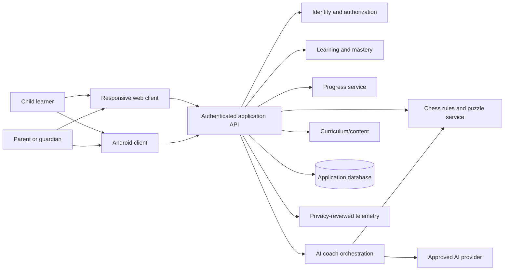

# Kids Chess Academy — Proposed Architecture

**Status:** Phase 0 proposal; validate before implementation  
**Platforms:** Web and Android  
**Date:** 2026-10-25

## 1. Principles

1. One product across two clients: shared curriculum IDs, mastery semantics, API contracts, and progress definitions.
2. Deterministic chess rules: a trusted rules engine owns legal moves and game state; an LLM is never authoritative for legality.
3. Evidence-based mastery: versioned assessment rules determine mastery, not elapsed time or UI clicks.
4. Child safety by default: data minimization, private profiles, guardian controls, no public social features in MVP.
5. Explicit integration status: demo/mock and production modes must be distinguishable in configuration and UI.
6. Backend source of truth: authentication, authorization, curriculum publication, and official progress are validated server-side.
7. Testable modules and progressive delivery: begin with a vertical slice; split services only when scale or trust boundaries justify it.

## 2. Logical context

This is a proposed logical model, not a claim that these services already exist. A modular monolith is a reasonable first deployment, with explicit modules and isolated adapters for chess, AI, and voice.

## 3. Client responsibilities

### Web
- Responsive learner and guardian journeys: onboarding, learning journey, lesson player, practice, puzzles, coach, progress, and parent area.
- Accessible reusable components and design tokens.
- Typed API client, authentication handling, safe retries, and clear offline/error states.
- No secrets or privileged business rules in browser code.

### Android
- Native Android or an approved cross-platform framework; choose after a technical spike.
- Touch-first board, scalable typography, accessible controls, lifecycle/network handling, and secure session storage.
- Review notification privacy, deep links, supported Android versions, and app-store requirements before launch.
- A responsive web page alone does not establish Android readiness.

### Shared contracts
- Stable IDs for curriculum, lessons, concepts, puzzles, assessment items, and progress events.
- Shared API schemas and contract tests.
- Server-defined mastery semantics; clients adapt presentation to age band.
- Versioning and compatibility policy for API and event changes.

## 4. Backend modules

- **Identity/authorization:** authentication, sessions, guardian-child relationships, consent, recovery, roles, and access checks.
- **Curriculum/content:** versioned modules, lessons, objectives, prerequisites, age-band variants, duration, assets, review state, and publication.
- **Chess rules/puzzles:** validated positions, legal move generation, move application, terminal/draw state, puzzle solution validation, and deterministic results.
- **Learning/mastery:** attempts, assessment evidence, prerequisites, remediation, concept status, and next activity recommendations.
- **Progress:** lesson/puzzle/game events, derived summaries, idempotency, and cross-device conflict rules.
- **AI coach orchestration:** input validation, bounded lesson/position context, safety checks, output structure, timeout/rate/cost limits, and safe fallback.
- **Parent reporting:** summaries derived from authorized learner data; distinguish observed activity from recommendations.
- **Notifications/telemetry (later):** opt-in, minimal payloads, and privacy-reviewed event definitions.

## 5. Chess rules boundary

Use a well-tested chess rules library, selected after the stack is decided. Cover:
- legal move generation and application;
- check, checkmate, stalemate, castling, en passant, and promotion;
- repetition, insufficient material, and move-count draw conditions;
- position/FEN validation;
- undo/replay correctness and puzzle solution validation.

AI can explain engine-validated facts and candidate moves, but must not decide whether a move is legal. The current prototype's selectable board is not a chess engine.

## 6. Logical data model

| Entity | Purpose and key concerns |
|---|---|
| User | Adult authentication subject; minimize stored personal fields |
| LearnerProfile | Age band/preferences and protected guardian relationship |
| GuardianRelationship | Scope, status, revocation, auditability |
| ConsentRecord | Type, status, timestamp, policy version, withdrawal |
| CurriculumVersion | Immutable published snapshot for historical interpretation |
| Module / Lesson | Objectives, prerequisites, age variants, duration, review status |
| Concept | Stable skill/rule identifier for mastery |
| AssessmentItem / Puzzle | Position, prompt, accepted solutions, deterministic validation |
| LearningAttempt | Response/outcome/timestamps; minimize free text |
| MasteryRecord | Derived concept state and evidence summary with algorithm version |
| PracticeSession / Game | Moves, result, settings, timestamps, retention policy |
| CoachInteraction | Minimal metadata and retention controls |
| AuditEvent | Privileged/security actions; never log secrets |

This is a logical model, not a finalized physical schema. Exact fields, indexes, retention, and data residency require the selected stack and privacy review.

## 7. API contract outline

Use a versioned prefix such as `/api/v1`; exact REST/RPC style remains a decision. Representative resources:
- `GET /curriculum`
- `GET /lessons/{lessonId}`
- `GET /learners/{learnerId}/journey`
- `POST /lessons/{lessonId}/attempts`
- `POST /puzzles/{puzzleId}/attempts`
- `POST /games/{gameId}/moves`
- `GET /learners/{learnerId}/progress`
- `POST /coach/responses`
- `GET /guardian/learners`
- `GET /guardian/learners/{learnerId}/summary`
- consent and account closure/deletion workflows

Every learner-scoped route must verify the authenticated subject's relationship and scope. Define request IDs, idempotency, validation errors, rate limits, pagination, and compatibility before production. Never trust a learner ID supplied by the client by itself.

## 8. AI and voice boundary

The coach receives only necessary, validated context: current objective, age band, board position, and trusted chess facts. It must not receive unrelated family/profile data. Apply child-safety rules, output checks, timeout/rate/cost controls, and a clear fallback. Voice must be optional, show microphone/recording state, offer text alternatives, and document processing location and retention. Never represent a simulated answer as a live AI response.

## 9. Security and privacy

- TLS in transit; protected credentials/tokens and server-managed secrets.
- Least privilege and server-side checks on every learner-scoped operation.
- Rate limits for authentication, coach, and game/puzzle endpoints.
- Defined retention/deletion behavior for profiles, progress, coach interaction, voice data, and backups.
- No public child profiles, open direct messaging, or behavioral advertising in MVP.
- Incident response, support escalation, vendor assessment, and privacy/legal review before child-facing pilot.
- No real child data in development or demo environments.

This is an engineering proposal, not legal advice; requirements must be reviewed for target launch jurisdictions.

## 10. Reliability and observability

Measure API latency/error rates, chess validation failures, progress sync outcomes, coach latency/cost, and Android crash-free sessions. Avoid logging tokens, secrets, and unnecessary child-generated text. Use internal request/correlation IDs without exposing them as public child identifiers.

Define network interruption behavior explicitly:
- mark unsynced activity;
- retry idempotently;
- resolve multi-device conflicts with documented server rules;
- do not show a saved/success state until the write is confirmed.

## 11. Testing

- Unit tests for mastery, authorization, content validation, and progress calculations.
- Chess rules regression tests and puzzle validation.
- API contract tests and negative guardian/learner access tests.
- Web responsive, keyboard, screen-reader, and accessibility checks.
- Android device/API-level, lifecycle, offline, touch, and accessibility tests.
- Cross-platform end-to-end tests on the same account.
- AI evaluations for age appropriateness, chess factuality, hallucinated moves, prompt injection, safe redirection, and fallback.
- CI linting, dependency/secret scanning, and release gates.

## 12. Environments and deployment

Use local development, CI/test, staging with synthetic data, and production. Keep demo fixtures and mock integrations isolated from production credentials. Feature flags may roll out coach/voice, but cannot bypass authorization. Start with a modular monolith unless independent scaling or trust boundaries justify splitting services.

## 13. Architecture decisions

| Decision | Proposal/status |
|---|---|
| Platform priority | Web and Android in parallel — confirmed |
| Backend shape | Modular monolith initially — proposed |
| Chess legality | Trusted rules library — required principle; library TBD |
| AI authority | Explain only; never source of legality — required |
| Official progress | Server-authoritative — required |
| Demo labeling | Explicit and isolated — required |
| Android framework | Native vs cross-platform spike — open |
| Web framework | Decide after repository/team review — open |
| Backend/database/hosting | Decide after deployment/privacy review — open |
| AI/voice providers | Provider and data flow TBD — open |
| Offline semantics | Define scope and conflict behavior — open |

## 14. Architecture exit criteria

- Client/backend responsibilities and trust boundaries reviewed.
- Chess library approach and regression coverage agreed.
- Guardian/learner authorization model reviewed.
- Logical data model and API contracts support a vertical slice.
- Web/Android implementation decision backed by a technical spike.
- AI/voice data flow, mock mode, safety fallback, and cost controls documented.
- Deployment, observability, test strategy, and release gates agreed.
